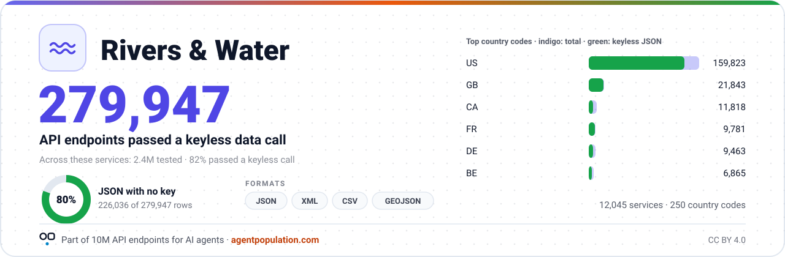
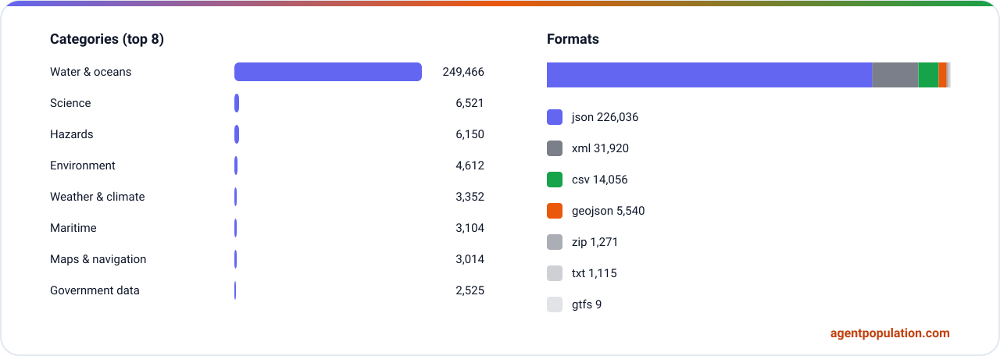

<p align="center"></p>

# 🌊 Rivers and water API endpoints

**279,947 river and water API endpoints that answered a keyless GET with a data body. For agent and app builders.**

<p align="center"><a href="#files"></a> <a href="#columns-and-tags"></a> <a href="#whats-inside"></a> <a href="#whats-inside"></a> <a href="LICENSE"></a></p>

<p align="center"><a href="#whats-in-it-for-you">What's in it</a> · <a href="#for-ai-agents">For AI agents</a> · <a href="#quick-start">Quick start</a> · <a href="#test-it-yourself">Test it yourself</a> · <a href="#files">Files</a> · <a href="#licence-and-credit">Licence</a> · <a href="#part-of-10m-api-endpoints-for-ai-agents">More packs</a></p>

This repository holds a 1,000-row sample and the services list; the full list of 279,947 endpoints is one download from the [latest release](https://github.com/agentpopulation/270k-water-apis-for-agents/releases/latest).

**Endpoints for building a river, flood or tide agent or app.** River gauges, flood stations, tide and current predictions, ocean datasets and groundwater wells, as URLs that answered with no key on their test date.

Selection rule: rows where `tags has rivers OR tags has floods OR tags has tides OR tags has oceans OR tags has groundwater OR tags has water`, less the rows that a leave-out rule drops (each counted under Known limits).

187,980 of these 279,947 rows match the focus rule (below); the others are in the pack by the selection rule only, and Known limits says what they are. 70,440 rows (25.2%) are map layers on ArcGIS Online, where anyone can publish.

## In plain words

**What is an API endpoint?** An API endpoint is one web address that a program can ask for data, for example the latest reading at one weather station. A single service, such as a national weather agency, can have thousands of endpoints: one per station, city or dataset. This pack counts endpoints, not separate services.

**What does "passed a data call" mean?** On the date shown in each row, AgentPopulation sent one plain request to that address, with no password or key, and got a non-empty data body back (JSON, CSV, XML or a file): not an error page and not an empty result. Some bodies describe a dataset rather than hold its values; see Known limits. It shows the address answered with data on that day. It is not a promise that it answers today, and licences and usage limits were not reviewed.

## What's in it for you

Four ways to use this pack. Each bucket gives a count, a filter you can apply to the CSV, one example that passed, and a list of recommended starting points with the rule that picked them. Buckets overlap; a row can fit more than one.

Examples, recommended lists and the preview are drawn from rows that match this pack's focus rule, so a row that a tag put in this pack but that is about something else is not shown as a starting point. Counts cover the whole bucket.

<details>
<summary>The focus rule</summary>

Focus rule: `category in ("Hydrology & Oceans", "Hazards", "Maritime") AND NOT title matches /\(\)$/i AND title matches /\b(hub.eau|usgs|noaa|nappes?|river|water|level|gauge|flow|discharge|tide|tidal|ocean|sea|wave|groundwater|well|flood|rain|hydro|lake|reservoir|stream|buoy|current|piezo|erddap|niveau|débit|pegel|wasser|coast|marine)/i`

</details>

### 🤖 Agent tools: River gauge and water-level lookups

**42,576** endpoints from 3,914 services · Wrap a gauge URL as a get_river_level tool: pass the site id, return the latest level and time.

14,023 of these are ArcGIS map layers (river, water level, hydrology) rather than gauge readings.

Start with: `tags has agent-ready AND tags has rivers AND title matches /river|water level|gauge|discharge|hydrology|waterway/i AND NOT url contains "/erddap/info/" AND NOT title matches /\(\)$/i`

Example: [EA hydrology: Chantry Gauge](https://environment.data.gov.uk/hydrology/id/measures/cf26c254-b152-4c3e-892d-759284556293-rainfall-t-86400-mm-qualified/readings?latest) · UK Environment Agency data · passed 2026-11-14

<details>
<summary>Recommended starting points: 8 services, picked by the stated criteria inside</summary>

**Recommended starting points.** Selected by stated criteria, not a ranking of quality: Services in this pack with the most endpoints that match this bucket and are tagged `agent-ready` (no key sent in the test call, JSON body, passed a data call). Ties go to the service with more country codes, then by name. Only services with at least one bucket row that matches the focus rule are listed, and the sample comes from those rows; the counts cover the whole bucket. The sample URL is the first row by URL sort after preferring, in this order: rows that match the bucket's sample preference when it has one, rows that return values rather than describe a dataset or a service (not ERDDAP /info/ pages, OGC GetCapabilities requests, bare OWS addresses, PxWeb tables, UN SDG series lists, Statistics Canada download pointers, WorldPop listings, GTFS validation reports, untitled rows or service root addresses), and agent-ready rows. Sample preference in this bucket: `title matches /gauge/i`. Services named "ArcGIS organization" hold map layers from many owners and are added only when fewer than 5 other services match.

| Service (host) | Endpoints in bucket | In pack | Country codes in bucket | Formats in bucket | Sample URL that passed |
|---|---:|---:|---|---|---|
| UK Environment Agency data (environment.data.gov.uk) | 8,841 | 12,115 | GB | json | [EA hydrology: Chantry Gauge](https://environment.data.gov.uk/hydrology/id/measures/cf26c254-b152-4c3e-892d-759284556293-rainfall-t-86400-mm-qualified/readings?latest) (2026-11-14) |
| HubEau (French water data) (hubeau.eaufrance.fr) | 7,289 | 7,289 | FR | json | [Hub'Eau groundwater level: Gaugeac (083…](https://hubeau.eaufrance.fr/api/v1/niveaux_nappes/chroniques?code_bss=08316X0017/Z9&size=20&sort=desc) (2026-11-14) |
| USGS Water Services (waterservices.usgs.gov) | 5,070 | 17,067 | GU, US | json | [USGS real-time: St. John River At Ninem…](https://waterservices.usgs.gov/nwis/iv/?format=json&sites=01010000&period=PT6H) (2026-11-14) |
| Doi (doi.org) | 1,121 | 3,673 | global or unknown | json | [Characterizing Uncertainty in Daily Str…](https://doi.org/10.5066/F73X8556) (2026-11-15) |
| Open Meteo (flood-api.open-meteo.com) | 835 | 835 | 186 codes | json | [Open-Meteo/GloFAS river discharge near …](https://flood-api.open-meteo.com/v1/flood?latitude=-0.299&longitude=73.424&daily=river_discharge) (2026-11-14) |
| NOAA CO-OPS tides and currents (api.tidesandcurrents.noaa.gov) | 818 | 7,098 | US | json | [NOAA CO-OPS Tides & Currents: CO-OPS la…](https://api.tidesandcurrents.noaa.gov/api/prod/datagetter?date=latest&datum=MLLW&station=1611400&product=water_level&units=metric&time_zone=gmt&format=json&application=AgentPopulation) (2026-11-14) |
| Wsv (www.pegelonline.wsv.de) | 787 | 791 | DE | json | [PEGELONLINE water level: VERSEN TRENNSP…](https://www.pegelonline.wsv.de/webservices/rest-api/v2/stations/0024cc40-d690-468d-84f9-4e9bf45d9108.json?includeTimeseries=true&includeCurrentMeasurement=true) (2026-11-14) |
| hsi-sh.de | 694 | 2,421 | DE | json | [Groundwater level measuring point 5563 …](https://hsi-sh.de/gw/od/10L01006001_w_messwerte.json) (2026-11-14) |

</details>

### 📱 App features: Flood watch maps and tide cards

**43,976** endpoints from 5,220 services · Show flood warnings on a map and tide times on a card.

Start with: `tags has floods OR tags has tides`

Example: [NOAA CO-OPS Tides & Currents: CO-OPS latest water…](https://api.tidesandcurrents.noaa.gov/api/prod/datagetter?date=latest&datum=MLLW&station=1611400&product=water_level&units=metric&time_zone=gmt&format=json&application=AgentPopulation) · NOAA CO-OPS tides and currents · passed 2026-11-14

<details>
<summary>Recommended starting points: 8 services, picked by the stated criteria inside</summary>

**Recommended starting points.** Selected by stated criteria, not a ranking of quality: Services in this pack with the most endpoints that match this bucket and passed a data call. Ties go to the service with more country codes, then by name. Only services with at least one bucket row that matches the focus rule are listed, and the sample comes from those rows; the counts cover the whole bucket. The sample URL is the first row by URL sort after preferring, in this order: rows that match the bucket's sample preference when it has one, rows that return values rather than describe a dataset or a service (not ERDDAP /info/ pages, OGC GetCapabilities requests, bare OWS addresses, PxWeb tables, UN SDG series lists, Statistics Canada download pointers, WorldPop listings, GTFS validation reports, untitled rows or service root addresses), and agent-ready rows. Services named "ArcGIS organization" hold map layers from many owners and are added only when fewer than 5 other services match.

| Service (host) | Endpoints in bucket | In pack | Country codes in bucket | Formats in bucket | Sample URL that passed |
|---|---:|---:|---|---|---|
| NOAA CO-OPS tides and currents (api.tidesandcurrents.noaa.gov) | 7,098 | 7,098 | US | json | [NOAA CO-OPS Tides & Currents: CO-OPS la…](https://api.tidesandcurrents.noaa.gov/api/prod/datagetter?date=latest&datum=MLLW&station=1611400&product=water_level&units=metric&time_zone=gmt&format=json&application=AgentPopulation) (2026-11-14) |
| UK Environment Agency data (environment.data.gov.uk) | 4,753 | 12,115 | GB, US | json, csv | [Flood Maps for Planning (Flood Zone 2, …](https://environment.data.gov.uk/KB6uNVj5ZcJr7jUP/ArcGIS/rest/services/Flood_Map_for_Planning/FeatureServer/0/query?where=1%3D1&outFields=*&returnGeometry=false&resultRecordCount=5&f=json) (2026-11-15) |
| Noaa (opendap.co-ops.nos.noaa.gov) | 1,017 | 1,017 | US | xml, json | [ERDDAP COOPS-NOS: Air Gap](https://opendap.co-ops.nos.noaa.gov/erddap/info/IOOS_Air_Gap/index.json) (2026-11-14) |
| GIS WebTech (ArcGIS Online) (services6.arcgis.com) | 858 | 873 | US | json | [2685 Riverport Road- property Outline](https://services6.arcgis.com/BAJNi3EgCdtQ1BCG/arcgis/rest/services/2685%20Riverport%20RoadProperty%20Outline%20Publish185/FeatureServer/0/query?where=1%3D1&outFields=*&returnGeometry=false&resultRecordCount=5&f=json) (2026-11-14) |
| Open Meteo (flood-api.open-meteo.com) | 835 | 835 | 186 codes | json | [Open-Meteo/GloFAS river discharge near …](https://flood-api.open-meteo.com/v1/flood?latitude=-0.299&longitude=73.424&daily=river_discharge) (2026-11-14) |
| Usgs (data.usgs.gov) | 678 | 11,699 | US | xml | [SIR2016-5029\_cfwgoshor\_6: Flood Inundat…](https://data.usgs.gov/datacatalog/metadata/USGS.03a63300-4e2e-4ec9-a20c-e9666637fef6.xml) (2026-11-15) |
| NOAA GeoPlatform (ArcGIS Online) (services2.arcgis.com) | 383 | 1,076 | US | json | [1964 Flood Dec 19-26 Precipitation](https://services2.arcgis.com/C8EMgrsFcRFL6LrL/arcgis/rest/services/1964_Flood_Dec_19_26_Precipitation/FeatureServer/0/query?where=1%3D1&outFields=*&returnGeometry=false&resultRecordCount=5&f=json) (2026-11-14) |
| Lsaurl (hvz.lsaurl.de) | 372 | 372 | DE | json | [Landesbetrieb fuer Hochwasserschutz und…](https://hvz.lsaurl.de/fileadmin/Bibliothek/Politik_und_Verwaltung/MLU/HVZ/KISTERS/data/internet/stations/BB/5530500/Q/week.json) (2026-11-15) |

</details>

### 🧠 Grounding and data pipelines: Ocean, tide and groundwater datasets

**113,774** endpoints from 3,608 services · Load ocean, tide and groundwater series on a schedule into your own store.

44,704 of these are ERDDAP dataset descriptions (/erddap/info/); the series needs a second request.

Start with: `tags has oceans OR tags has groundwater OR format is csv`

Example: [TAMU (ERDDAP gcoos5.geos.tamu.edu): ERDDAP gridda…](https://gcoos5.geos.tamu.edu/erddap/griddap/HFradar_TAMU_GERG.json?time%5Blast%5D) · Tamu · passed 2026-11-15

<details>
<summary>Recommended starting points: 8 services, picked by the stated criteria inside</summary>

**Recommended starting points.** Selected by stated criteria, not a ranking of quality: Services in this pack with the most endpoints that match this bucket and passed a data call. Ties go to the service with more country codes, then by name. Only services with at least one bucket row that matches the focus rule are listed, and the sample comes from those rows; the counts cover the whole bucket. The sample URL is the first row by URL sort after preferring, in this order: rows that match the bucket's sample preference when it has one, rows that return values rather than describe a dataset or a service (not ERDDAP /info/ pages, OGC GetCapabilities requests, bare OWS addresses, PxWeb tables, UN SDG series lists, Statistics Canada download pointers, WorldPop listings, GTFS validation reports, untitled rows or service root addresses), and agent-ready rows. Sample preference in this bucket: `NOT url contains "/erddap/info/"`. Services named "ArcGIS organization" hold map layers from many owners and are added only when fewer than 5 other services match.

| Service (host) | Endpoints in bucket | In pack | Country codes in bucket | Formats in bucket | Sample URL that passed |
|---|---:|---:|---|---|---|
| GRIIDC ERDDAP (Gulf of Mexico) (erddap.griidc.org) | 11,688 | 11,688 | US | json | [ERDDAP GRIIDC: Trajectory - F2.x836.000…](https://erddap.griidc.org/erddap/info/F2_x836_000_0005_Backscatter_SHELF_FMG_sonar_data/index.json) (2026-11-14) |
| Tamu (gcoos5.geos.tamu.edu) | 7,739 | 7,739 | US | json, xml | [TAMU (ERDDAP gcoos5.geos.tamu.edu): ERD…](https://gcoos5.geos.tamu.edu/erddap/griddap/HFradar_TAMU_GERG.json?time%5Blast%5D) (2026-11-15) |
| Usgs (data.usgs.gov) | 5,392 | 11,699 | US | xml | [Raw HYPACK navigation logs (text) colle…](https://data.usgs.gov/datacatalog/metadata/USGS.0000a76f-c6be-4366-8be3-6f8487442e8a.xml) (2026-11-15) |
| Glos (seagull-erddap.glos.org) | 3,619 | 3,619 | US | json | [National Data Buoy Center (ERDDAP seagu…](https://seagull-erddap.glos.org/erddap/info/45001_archive/index.json) (2026-11-15) |
| Noaa (data.ngdc.noaa.gov) | 3,261 | 3,261 | US | csv, xml | [B00002: NOS Hydrographic Survey , 1984-…](https://data.ngdc.noaa.gov/platforms/ocean/nos/coast/B00001-B02000/B00002/GEODAS/B00002.a93.gz) (2026-11-15) |
| USGS Water Services (waterservices.usgs.gov) | 3,175 | 17,067 | PR, US | json | [USGS National Water Information System:…](https://waterservices.usgs.gov/nwis/dv/?format=json&sites=01411318&period=P30D) (2026-11-15) |
| HubEau (French water data) (hubeau.eaufrance.fr) | 3,174 | 7,289 | FR | json | [Hub'Eau groundwater level: Saint-George…](https://hubeau.eaufrance.fr/api/v1/niveaux_nappes/chroniques?code_bss=00035X0210/PZO1&size=20&sort=desc) (2026-11-14) |
| Bodc (erddap.bodc.ac.uk) | 2,529 | 2,529 | GB | json | [Marine Scotland Science (ERDDAP erddap.…](https://erddap.bodc.ac.uk/erddap/info/10007_0210S_CTD/index.json) (2026-11-15) |

</details>

### 🧪 Evals and testing: Varied responses for tool-call tests

**279,947** endpoints · 12,045 services · 250 country codes · 7 formats · Run your tool calls against a fixed set of URLs across formats and record which answer; last_tested is the baseline for your own re-tests.

Start with: the whole pack

Example: [USGS National Water Information System: NWIS dail…](https://waterservices.usgs.gov/nwis/dv/?format=json&sites=01124350&period=P30D) · USGS Water Services · passed 2026-11-15

<details>
<summary>Recommended starting points: 8 services, picked by the stated criteria inside</summary>

**Recommended starting points.** Selected by stated criteria, not a ranking of quality: Services in this pack that returned the most different formats, then the most endpoints that passed a data call, then by name: a mix of response shapes to test parsers and tool calls. Only services with at least one bucket row that matches the focus rule are listed, and the sample comes from those rows; the counts cover the whole bucket. The sample URL is the first row by URL sort after preferring, in this order: rows that match the bucket's sample preference when it has one, rows that return values rather than describe a dataset or a service (not ERDDAP /info/ pages, OGC GetCapabilities requests, bare OWS addresses, PxWeb tables, UN SDG series lists, Statistics Canada download pointers, WorldPop listings, GTFS validation reports, untitled rows or service root addresses), and agent-ready rows. Services named "ArcGIS organization" hold map layers from many owners and are added only when fewer than 5 other services match.

| Service (host) | Endpoints in bucket | In pack | Country codes in bucket | Formats in bucket | Sample URL that passed |
|---|---:|---:|---|---|---|
| Caribbeanmarineatlas (www.caribbeanmarineatlas.net) | 684 | 684 | global or unknown | zip, xml, json, geojson, csv | [TV\_Global Distribution of Sea Turtle Ne…](https://www.caribbeanmarineatlas.net/geoserver/ows?service=WFS&version=1.0.0&request=GetFeature&typename=geonode%3Aa__014_001_wcmc007_turtlenestingsites1999_v1_1&outputFormat=json&srs=EPSG%3A4326&srsName=EPSG%3A4326) (2026-11-15) |
| Canadian Urban Data Catalogue (CUDC) (geohub.saskatchewan.ca) | 520 | 520 | CA | csv, xml, json, geojson, zip | [Lake Water Geochemistry - GeoJSON](https://geohub.saskatchewan.ca/api/download/v1/items/21bfb31dc2a3490e9fcc3de695343424/geojson?layers=0) (2026-11-15) |
| Napsgfoundation (prep-response-portal.napsgfoundation.org) | 452 | 452 | global or unknown | csv, xml, geojson, json, zip | [USA Detailed Streams - GeoJSON](https://prep-response-portal.napsgfoundation.org/api/download/v1/items/3428672decd64aeabcb8da15e9b749f0/geojson?layers=0) (2026-11-15) |
| ArcGIS Online: Vegetation (data-cdfw.opendata.arcgis.com) | 372 | 372 | US | csv, xml, json, geojson, zip | [California Marine Protected Areas \[ds58…](https://data-cdfw.opendata.arcgis.com/api/download/v1/items/117a99c8745a48c6a48bac70005b1b11/geojson?layers=0) (2026-11-15) |
| ArcGIS Online: opendata (opendata-daerani.hub.arcgis.com) | 355 | 355 | GB | csv, json, xml, geojson, zip | [River Water Quality Monitoring 1990 to …](https://opendata-daerani.hub.arcgis.com/api/download/v1/items/0ee76793c9584d2a908fd902f724534b/geojson?layers=0) (2026-11-15) |
| California Natural Resources Agency Open (gis.data.cnra.ca.gov) | 242 | 242 | US | csv, json, xml, geojson, zip | [i07 Water Shortage Vulnerability Sectio…](https://gis.data.cnra.ca.gov/api/download/v1/items/044bb017785449d3a3fe334923930c7a/geojson?layers=0) (2026-11-15) |
| data.gov.au (datahub.moretonbay.qld.gov.au) | 215 | 215 | AU | json, csv, geojson, zip, xml | [MBRC Planning Scheme - Flood Hazard Ove…](https://datahub.moretonbay.qld.gov.au/api/download/v1/items/1a69bf67f3b24138ab5aa726f350e7f8/geojson?layers=0) (2026-11-15) |
| data.gis.ny.gov | 81 | 81 | US | json, zip, csv, geojson, xml | [Water Quality Classifications (Line) - …](https://data.gis.ny.gov/api/download/v1/items/258fe1be90ff48f385a546cdfd998e24/geojson?layers=1) (2026-11-15) |

</details>

The same lists are in [recommended.json](recommended.json), ready for an agent to load.

## Questions an agent can answer with this pack

- What is the latest water level at a NOAA tide station? Try [NOAA CO-OPS Tides & Currents: CO-OPS latest water…](https://api.tidesandcurrents.noaa.gov/api/prod/datagetter?date=latest&datum=MLLW&station=1611400&product=water_level&units=metric&time_zone=gmt&format=json&application=AgentPopulation) (NOAA CO-OPS tides and currents, passed 2026-11-14).
- How has a US river gauge moved over the last six hours? Try [USGS real-time: St. John River At Ninemile Bridge…](https://waterservices.usgs.gov/nwis/iv/?format=json&sites=01010000&period=PT6H) (USGS Water Services, passed 2026-11-14).
- What river discharge is forecast near a given point? Try [Open-Meteo/GloFAS river discharge near Fuvahmulah…](https://flood-api.open-meteo.com/v1/flood?latitude=-0.299&longitude=73.424&daily=river_discharge) (Open Meteo, passed 2026-11-14).

## What "passed a data call" means

> [!NOTE]
> On the date in `last_tested` (IST), one GET to the URL, sent with no key, returned HTTP 2xx and a non-empty data body. HTML pages and empty results did not pass. The `format` column records what came back. This is a test result for that date, not a promise that the URL answers today. Licences, terms, rate limits, accuracy and freshness were not reviewed. Endpoints are URLs, not separate APIs; many share one service. This pack was tested 10–15 Nov 2026; snapshot 15 Nov 2026.

## For AI agents

Start from keyless JSON endpoints (`agent-ready`). The code below loads `recommended.json` and calls the first recommended service in the Agent tools bucket, with a timeout (`node examples/agent-start.mjs --recommended`). With no argument, `node examples/agent-start.mjs` calls the most recently tested agent-ready row of the sample; pass a `.csv` or `.csv.gz` path to use that file instead. See [examples/agent-start.mjs](examples/agent-start.mjs).

```js
// Node 18+. Loads recommended.json (the local copy, or the raw file on GitHub) and calls one keyless JSON endpoint.
import fs from 'node:fs';

const RAW = 'https://raw.githubusercontent.com/agentpopulation/270k-water-apis-for-agents/main/recommended.json';
const rec = fs.existsSync('recommended.json')
  ? JSON.parse(fs.readFileSync('recommended.json', 'utf8'))
  : await (await fetch(RAW)).json();

const pick = rec.buckets.find((b) => b.id === 'agent').services[0];
try {
  const res = await fetch(pick.sample_url, {
    headers: { 'User-Agent': 'agent-example/1.0' },
    signal: AbortSignal.timeout(15000),
  });
  console.log(pick.service, res.status, res.headers.get('content-type'));
  console.log((await res.text()).slice(0, 300));
} catch (err) {
  console.log(`did not answer now; last passed ${pick.sample_last_tested} (${err.message})`);
}
```

How an agent picks an endpoint:

1. Filter to `agent-ready` and your country or topic.
2. Prefer the newest `last_tested` and the larger services.
3. Call with a timeout and check the body before you use it.

## Quick start

The examples run against the sample in `data/` out of the box (1,000 rows). Each takes an optional path to a `.csv` or `.csv.gz` file instead.

```bash
git clone https://github.com/agentpopulation/270k-water-apis-for-agents.git
cd 270k-water-apis-for-agents
python examples/quickstart.py
node examples/quickstart.mjs
node examples/agent-start.mjs
```

Full list: download `Water_API_Endpoints_AgentPopulation_Snapshot_2026-11-15.csv.gz` (279,947 rows, 10.8 MB) from [releases/latest](https://github.com/agentpopulation/270k-water-apis-for-agents/releases/latest), then gunzip it and pass its path. The scripts also read the `.csv.gz` as it is.

```bash
gunzip Water_API_Endpoints_AgentPopulation_Snapshot_2026-11-15.csv.gz
python examples/quickstart.py Water_API_Endpoints_AgentPopulation_Snapshot_2026-11-15.csv
node examples/quickstart.mjs Water_API_Endpoints_AgentPopulation_Snapshot_2026-11-15.csv
```

### curl

Quote the URL: some contain commas.

```bash
curl -sL "https://raw.githubusercontent.com/agentpopulation/270k-water-apis-for-agents/main/data/Water_API_Endpoints_AgentPopulation_Sample.csv" | head -n 4
curl -s --max-time 15 "https://environment.data.gov.uk/hydrology/id/measures/cf26c254-b152-4c3e-892d-759284556293-rainfall-t-86400-mm-qualified/readings?latest" | head -c 600
```

### Python

Standard library only: [examples/quickstart.py](examples/quickstart.py) reads the sample, or the path you pass, keeps agent-ready rows and calls the most recently tested one.

<details>
<summary>The code</summary>

```python
# Python 3, standard library only. Run from a clone of this repository:
#   python examples/quickstart.py [path]
# With no path it reads the sample in data/. Pass the full list from the latest release (.csv or .csv.gz) instead.
# Keeps agent-ready rows and calls the most recently tested one.
import csv
import gzip
import os
import re
import sys
import urllib.request

HERE = os.path.dirname(os.path.abspath(__file__))
path = sys.argv[1] if len(sys.argv) > 1 else os.path.join(HERE, "..", "data", "Water_API_Endpoints_AgentPopulation_Sample.csv")
opener = gzip.open if path.endswith(".gz") else open
with opener(path, "rt", newline="", encoding="utf-8") as f:
    rows = list(csv.DictReader(f))

agent = [r for r in rows if "agent-ready" in r["tags"].split("|")]
# Newest test date first; URLs that describe a dataset or a service rather than return values go last.
DESCRIBES = re.compile(r"/erddap/info/|action-report\.json$|[?&]request=getcapabilities|/GeoArea/[^/?]+/List|getFullTableDownloadCSV|hub\.worldpop\.org", re.I)
agent.sort(key=lambda r: r["last_tested"], reverse=True)
agent.sort(key=lambda r: 1 if DESCRIBES.search(r["url"]) else 0)
print(len(rows), "rows,", len(agent), "agent-ready")
if not agent:
    sys.exit(0)

row = agent[0]
req = urllib.request.Request(row["url"], headers={"User-Agent": "agent-example/1.0"})
try:
    with urllib.request.urlopen(req, timeout=15) as res:
        body = res.read(1_000_000).decode("utf-8", "replace")
        print(res.status, res.headers.get("Content-Type"))
        print(body[:300])
except Exception as err:
    print(f"did not answer now; last passed {row['last_tested']} ({err})")
```

</details>

### JavaScript

Reads the sample as JSON because the CSV has quoted commas.

<details>
<summary>The code</summary>

```js
// Node 18+. Reads the sample as JSON (the CSV has quoted commas), local file first.
import fs from 'node:fs';

const FILE = 'data/Water_API_Endpoints_AgentPopulation_Sample.json';
const rows = fs.existsSync(FILE)
  ? JSON.parse(fs.readFileSync(FILE, 'utf8'))
  : await (await fetch('https://raw.githubusercontent.com/agentpopulation/270k-water-apis-for-agents/main/data/Water_API_Endpoints_AgentPopulation_Sample.json')).json();

const row = rows.find((r) => r.tags.includes('agent-ready'));
const res = await fetch(row.url, { headers: { 'User-Agent': 'agent-example/1.0' }, signal: AbortSignal.timeout(15000) });
console.log(res.status, (await res.text()).slice(0, 300));
```

</details>

### Agent tools

[examples/agent-tools.json](examples/agent-tools.json) holds two tool definitions in the shape most tool-calling APIs accept (name, description, JSON Schema); rename `parameters` if yours uses another key. [examples/quickstart.mjs](examples/quickstart.mjs) implements them:

- `find_endpoints` searches the agent-ready rows of the list by words, country code (their format is json). When you load the tools of more than one pack, prefix the names (for example `water_find_endpoints`) so they do not clash.
- `fetch_endpoint` calls one URL, **refuses any URL that is not in the list** and does not follow redirects. The allowlist is built from the CSV, so a URL injected into a prompt is refused.

The same two tools can sit behind an MCP server.

## Test it yourself

Re-test endpoints from the sample with the same rule: HTTP 2xx and a non-empty body that is not an HTML page. Node 18+, no packages.

```bash
node tools/test-endpoints.mjs
```

It tests the first 50 URLs and prints one line: tested, passed, did not pass. Options: a `.csv` or `.csv.gz` path (the full list from the release), `--limit 50`, `--timeout-ms 10000`, `--out results.csv`. The results file holds `url`, `status`, `passed`, `content_type`, `ms` and `checked_at`; a status of `timeout` or `error:<code>` means no HTTP answer came back. It is polite: GET only, no key sent, at most 4 requests in flight, one at a time per listed host, at least 1 second between requests to one listed host, and reading stops once 256 kB of a body is kept. Redirects are followed and may lead to another host. `results.csv` is in `.gitignore`.

## Preview

One row from each of the five largest services among rows that match the focus rule, services with rows that return values first.

| Title | Service | Country | Format | Tested | Link |
|---|---|---|---|---|---|
| USGS National Water Information System: NWIS daily values (… | USGS Water Services | US | json | 2026-11-15 | [waterservices.usgs.gov](https://waterservices.usgs.gov/nwis/dv/?format=json&sites=01124350&period=P30D) |
| Flood Maps for Planning (Flood Zone 2, Flood Zone 3 and Flo… | UK Environment Agency data | GB | json | 2026-11-15 | [environment.data.gov.uk](https://environment.data.gov.uk/KB6uNVj5ZcJr7jUP/ArcGIS/rest/services/Flood_Map_for_Planning/FeatureServer/0/query?where=1%3D1&outFields=*&returnGeometry=false&resultRecordCount=5&f=json) |
| Raw HYPACK navigation logs (text) collected by the U.S. Geo… | Usgs | US | xml | 2026-11-15 | [data.usgs.gov](https://data.usgs.gov/datacatalog/metadata/USGS.0000a76f-c6be-4366-8be3-6f8487442e8a.xml) |
| TAMU (ERDDAP gcoos5.geos.tamu.edu): ERDDAP griddap (latest … | Tamu | US | json | 2026-11-15 | [gcoos5.geos.tamu.edu](https://gcoos5.geos.tamu.edu/erddap/griddap/HFradar_TAMU_GERG.json?time%5Blast%5D) |
| Hub'Eau groundwater level: Saint-Georges-sur-l'Aa (00035X02… | HubEau (French water data) | FR | json | 2026-11-14 | [hubeau.eaufrance.fr](https://hubeau.eaufrance.fr/api/v1/niveaux_nappes/chroniques?code_bss=00035X0210/PZO1&size=20&sort=desc) |

Browse the 1,000-row sample: [Sample CSV](data/Water_API_Endpoints_AgentPopulation_Sample.csv) · [Sample JSON](data/Water_API_Endpoints_AgentPopulation_Sample.json).

## What's inside

<p align="center"></p>

<details>
<summary>Country codes: 250</summary>

| Code | Country | Endpoints | |
|---|---|---:|---|
| US | United States | 159,823 | `████████████████████` |
| GB | United Kingdom | 21,843 | `██▊` |
| CA | Canada | 11,818 | `█▌` |
| FR | France | 9,781 | `█▎` |
| DE | Germany | 9,463 | `█▏` |
| BE | Belgium | 6,865 | `▉` |
| NZ | New Zealand | 6,829 | `▉` |
| AU | Australia | 4,807 | `▋` |
| EU | European Union | 4,399 | `▌` |
| IE | Ireland | 3,980 | `▌` |
| | other 240 codes | 20,562 | |
| | global or unknown | 19,777 | `██▌` |

</details>

<details>
<summary>Categories: top 8</summary>

| Category | Endpoints | |
|---|---:|---|
| Hydrology & Oceans | 249,466 | `████████████████████` |
| Science | 6,521 | `▌` |
| Hazards | 6,150 | `▌` |
| Environment | 4,612 | `▍` |
| Weather & Climate | 3,352 | `▎` |
| Maritime | 3,104 | `▎` |
| Navigation & Geo/Maps | 3,014 | `▎` |
| Government & Open Data | 2,525 | `▎` |

</details>

Formats: json 226,036 · xml 31,920 · csv 14,056 · geojson 5,540 · zip 1,271 · txt 1,115 · gtfs 9

<details>
<summary>Largest services: top 25 of 12,045</summary>

| Service | Host | Endpoints | Keyless JSON | |
|---|---|---:|---:|---|
| USGS Water Services | waterservices.usgs.gov | 17,067 | 17,067 | `████████████████████` |
| UK Environment Agency data | environment.data.gov.uk | 12,115 | 12,101 | `██████████████▎` |
| Usgs | data.usgs.gov | 11,699 | 0 | `█████████████▊` |
| GRIIDC ERDDAP (Gulf of Mexico) | erddap.griidc.org | 11,688 | 11,688 | `█████████████▊` |
| Tamu | gcoos5.geos.tamu.edu | 7,739 | 7,738 | `█████████▏` |
| HubEau (French water data) | hubeau.eaufrance.fr | 7,289 | 7,289 | `████████▌` |
| NOAA CO-OPS tides and currents | api.tidesandcurrents.noaa.gov | 7,098 | 7,098 | `████████▍` |
| Doi | doi.org | 3,673 | 3,673 | `████▎` |
| Glos | seagull-erddap.glos.org | 3,619 | 3,619 | `████▎` |
| Noaa | data.ngdc.noaa.gov | 3,261 | 0 | `███▉` |
| Bodc | erddap.bodc.ac.uk | 2,529 | 2,529 | `███` |
| hsi-sh.de | hsi-sh.de | 2,421 | 1,585 | `██▉` |
| Environment and Climate Change Canada GeoMet/MSC | api.weather.gc.ca | 2,234 | 27 | `██▋` |
| Sepa | timeseries.sepa.org.uk | 2,216 | 2,216 | `██▋` |
| Noaa | polarwatch.noaa.gov | 2,088 | 2,088 | `██▌` |
| Noaa | coastwatch.noaa.gov | 2,083 | 2,083 | `██▌` |
| hilltop.gw.govt.nz | hilltop.gw.govt.nz | 2,049 | 0 | `██▍` |
| Secoora | erddap.secoora.org | 2,040 | 2,040 | `██▍` |
| Waterlevel | waterlevel.ie | 2,033 | 0 | `██▍` |
| Bco Dmo | erddap.bco-dmo.org | 1,919 | 1,919 | `██▎` |
| DOV Flanders subsoil / water | www.dov.vlaanderen.be | 1,659 | 0 | `██` |
| Esipfed | geoport.usgs.esipfed.org | 1,469 | 1,469 | `█▊` |
| Voiceoftheocean | erddap.observations.voiceoftheocean.org | 1,375 | 1,375 | `█▋` |
| Icos Cp | erddap.icos-cp.eu | 1,189 | 1,189 | `█▍` |
| Cencoos | erddap.cencoos.org | 1,085 | 1,085 | `█▎` |

</details>

<details>
<summary>Rows per test date: 10–15 Nov 2026</summary>

| Date (IST) | Endpoints | |
|---|---:|---|
| 2026-11-15 | 137,747 | `███████████████████▊` |
| 2026-11-14 | 139,593 | `████████████████████` |
| 2026-11-13 | 823 | `▏` |
| 2026-11-12 | 1,427 | `▎` |
| 2026-11-11 | 356 | `▏` |
| 2026-11-10 | 1 | `▏` |

</details>

## Files

| File | Rows | Size | Use |
|---|---:|---:|---|
| [data/Water_API_Services_AgentPopulation.csv](data/Water_API_Services_AgentPopulation.csv) | 12,045 | 716.6 kB | One row per service with its endpoint count in this pack |
| [data/Water_API_Endpoints_AgentPopulation_Sample.csv](data/Water_API_Endpoints_AgentPopulation_Sample.csv) | 1,000 | 310.5 kB | The sample: focus-rule rows first, each service in proportion to its share; ArcGIS Online layers count as one service |
| [data/Water_API_Endpoints_AgentPopulation_Sample.json](data/Water_API_Endpoints_AgentPopulation_Sample.json) | 1,000 | 508.0 kB | The same rows as JSON, tags as an array |
| [Water_API_Endpoints_AgentPopulation_Snapshot_2026-11-15.csv.gz](https://github.com/agentpopulation/270k-water-apis-for-agents/releases/latest) | 279,947 | 10.8 MB | The full list, gzipped CSV: a download from the latest release, checked by `SHA256SUMS.txt` |
| [tools/test-endpoints.mjs](tools/test-endpoints.mjs) | | | Re-tests endpoints from the sample or the full list |

Sample size: 1,000 rows, which is 1,000 or one third of the pack rounded down, whichever is smaller. Rows that match the focus rule come first. Each service gets rows in proportion to its share of those rows, at least one for the largest services and at most 50% of the sample while other services have rows; ArcGIS Online layers count as one service, whatever their organisation. Within a service, agent-ready rows, rows that return values and the newest test dates come first, and rows are written in turn across services. Service root addresses are placed at the end of the sample.

Full list: download `Water_API_Endpoints_AgentPopulation_Snapshot_2026-11-15.csv.gz` (279,947 rows, 10.8 MB) from [releases/latest](https://github.com/agentpopulation/270k-water-apis-for-agents/releases/latest), then gunzip it and pass its path. The scripts also read the `.csv.gz` as it is.

Excel users: Data > From Text/CSV, UTF-8. Files are UTF-8 without a byte-order mark and comma-separated.

## Columns and tags

<details>
<summary>Columns, types and tags</summary>

| Column | Type | Example | Meaning |
|---|---|---|---|
| url | string | [https://waterservices.usgs.gov/nwis/dv/…](https://waterservices.usgs.gov/nwis/dv/?format=json&sites=01124350&period=P30D) | The address that was tested |
| title | string | USGS National Water Information System:… | Station, dataset or feed name |
| service | string | USGS Water Services | The service the endpoint belongs to; joins to the services file together with host |
| host | string | waterservices.usgs.gov | Host name of the address |
| country | string | US | ISO 3166-1 alpha-2 code, or EU; empty when global or unknown |
| category | string | Hydrology & Oceans | Category of the endpoint |
| subcategory | string |  | Left empty from the 15 Nov 2026 snapshot; kept so the columns stay the same |
| format | string | json | What the test call returned: json, csv, geojson, xml, gtfs, zip, txt and so on |
| tags | string | `water\|rivers\|no-key\|json\|agent-ready` | Tags separated by \| |
| last_tested | date | 2026-11-15 | Date of the test call, YYYY-MM-DD (IST) |

| Tag | Rows | Meaning |
|---|---:|---|
| no-key | 279,947 | No key was sent in the test call |
| water | 249,466 | Topic tag |
| agent-ready | 226,036 | No key sent, JSON body, passed a data call on last_tested |
| json | 226,036 | Format of the body |
| maps | 104,986 | Topic tag |
| rivers | 86,530 | Topic tag |
| oceans | 86,107 | Topic tag |
| open-data | 43,667 | Topic tag |
| xml | 31,920 | Format of the body |
| floods | 31,149 | Topic tag |
| science | 25,473 | Topic tag |
| environment | 21,130 | Topic tag |
| groundwater | 20,100 | Topic tag |
| weather | 16,696 | Topic tag |
| csv | 14,056 | Format of the body |
| tides | 13,966 | Topic tag |
| government | 11,477 | Topic tag |
| statistics | 9,878 | Topic tag |
| hazards | 6,427 | Topic tag |
| geojson | 5,540 | Format of the body |
| maritime | 4,131 | Topic tag |
| elevation | 2,438 | Topic tag |
| climate | 1,701 | Topic tag |
| forecast | 1,463 | Topic tag |
| transit | 1,353 | Topic tag |
| health | 1,138 | Topic tag |
| traffic | 1,133 | Topic tag |
| economy | 944 | Topic tag |
| energy | 923 | Topic tag |
| aviation | 663 | Topic tag |
| finance | 555 | Topic tag |
| air-quality | 400 | Topic tag |
| earthquakes | 226 | Topic tag |
| parking | 114 | Topic tag |
| tsunami | 92 | Topic tag |
| wildfire | 82 | Topic tag |
| volcanoes | 74 | Topic tag |
| ai-ml | 28 | Topic tag |
| geocoding | 24 | Topic tag |
| gtfs | 16 | GTFS feed |
| speech | 5 | Topic tag |
| mcp-server | 4 | Topic tag |
| llm | 2 | Topic tag |
| embeddings | 1 | Topic tag |

A machine-readable copy of this dictionary is in [datapackage.json](datapackage.json).

</details>

## Known limits

- 57.1% of rows carry country code US; 19,777 rows have no code (global or unknown).
- 248 rows come from PxWeb or Statistics Canada services. Some statistics endpoints return metadata or a pointer on GET; the table may need a second request or a POST.
- 44,704 rows are ERDDAP /info/ pages: they describe a dataset rather than return its values, so the series needs a second request.
- 88,218 rows are map-layer queries with resultRecordCount set: the tested call asked for a few records; change the query to get the full layer.
- 2,598 rows carry limit=1: the tested call asked for one record; raise the limit or page through.
- 2,724 rows are open-data portal dataset records, which may return a dataset record with links rather than the table itself.
- 2,386 rows are files (zip 1,271, txt 1,115) rather than bodies an agent reads directly.
- 70,440 rows are layers on ArcGIS Online, where anyone can publish: some are class projects, tests or copies. Check the owner and the fields before you rely on one.
- 6,768 URLs carry `application=AgentPopulation`; set your own application name when you call them.
- Stations and feeds can go quiet after their test date; re-test a URL before you rely on it.
- Not in this pack: endpoints that need a key or a POST, and URLs that did not pass.
- Left out: 1,023 rows whose URL carried a credential-looking parameter or a login.
- Left out: 1 row with an email-like address.
- Left out: 1,702 ArcGIS Survey123 layers (they can hold people's form answers).
- Left out: 2 camera or image URLs (webcam and camera feeds, picture and video files).
- Left out: 531 class-exercise copies of the same few ArcGIS Online layers (Miami Beach sea level rise, high-risk areas without shelter, flooded areas, sea level rise and storm surge maps) across many organisations, many with a person's name in the title.
- Left out: 11 layers marked editable in the title (they can hold entries that people added).
- Left out: 326 ArcGIS layers that keep a form's default service name (they can hold people's form answers).
- Left out: 2,170 ArcGIS class or coursework layers (lab, assignment, exam, quiz, lesson, exercise, tutorial and final-project layers, copies of class layers, layers named for a person or a person's home, and layers whose name ends in a person's name or holds a student number).
- Left out: 126 ArcGIS layers that hold reports, comments, submissions or form responses sent in by the public.
- Left out: 116 rows of server information from Mastodon, PeerTube, Lemmy, Nostr and other social network servers (instance documents name the server's contact person).

## Licence and credit

> [!IMPORTANT]
> This list (URLs, titles, tags and test results) is © 2026 AgentPopulation, released under [CC BY 4.0](https://creativecommons.org/licenses/by/4.0/). Credit AgentPopulation and link agentpopulation.com. The data each endpoint returns belongs to its provider and stays under that provider's terms; this licence does not cover it.

Copy-ready credit:

`Rivers and water API endpoints by AgentPopulation (https://agentpopulation.com), CC BY 4.0, snapshot 15 Nov 2026.`

GitHub's "Cite this repository" button reads [CITATION.cff](CITATION.cff).

<!-- agentpopulation:start -->
## Part of 10M API endpoints for AI agents

This pack is one of the 24 topic packs of [10m-open-apis-for-ai-agents](https://github.com/agentpopulation/10m-open-apis-for-ai-agents), the open collection by [AgentPopulation](https://agentpopulation.com). Target: 10 million+ open API endpoints that pass a keyless API call.

AgentPopulation has tested over 5 million API endpoints: 5,129,834 tested, 3,726,509 passed a data call (snapshot 15 Nov 2026). This is the river and water pack: 279,947 endpoints from 12,045 services. Packs overlap, so an endpoint can appear in more than one.

For the latest tested endpoints, search [agentpopulation.com/apis](https://agentpopulation.com/apis). This pack is a snapshot from 15 Nov 2026.

Sibling packs that share the most URLs with this one: [2.5m-agent-ready-apis](https://github.com/agentpopulation/2.5m-agent-ready-apis) (226,036 shared) · [86k-oceans-apis-for-agents](https://github.com/agentpopulation/86k-oceans-apis-for-agents) (86,107 shared) · [190k-weather-apis-for-agents](https://github.com/agentpopulation/190k-weather-apis-for-agents) (17,630 shared) · [380k-science-apis-for-agents](https://github.com/agentpopulation/380k-science-apis-for-agents) (6,521 shared) · [53k-hazards-apis-for-agents](https://github.com/agentpopulation/53k-hazards-apis-for-agents) (6,148 shared) · [170k-environment-apis-for-agents](https://github.com/agentpopulation/170k-environment-apis-for-agents) (4,612 shared). The rest are listed in [10m-open-apis-for-ai-agents](https://github.com/agentpopulation/10m-open-apis-for-ai-agents).

Questions, pack requests, reports of endpoints that stopped answering and requests to remove a row go to [Discussions](https://github.com/agentpopulation/10m-open-apis-for-ai-agents/discussions), or to [@agentpopulation](https://x.com/agentpopulation) on X. The packs are a work in progress and corrections are welcome.

Spotted a wrong row or a dead URL? Tell us on X: [@agentpopulation](https://x.com/agentpopulation).

If this pack saved you time, a star helps others find it.

---

Compiled by [AgentPopulation](https://agentpopulation.com) with [AP Desk](https://github.com/agentpopulation/apdesk) · [10m-open-apis-for-ai-agents](https://github.com/agentpopulation/10m-open-apis-for-ai-agents)

<!-- agentpopulation:end -->
